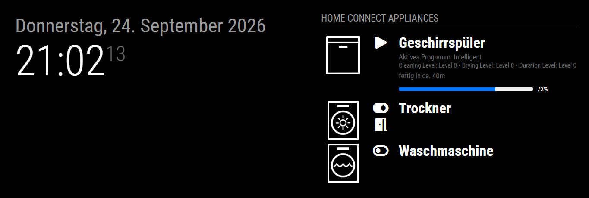
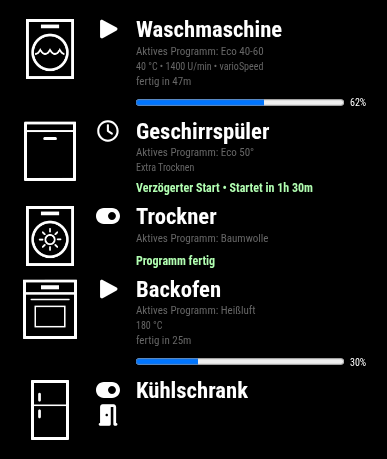
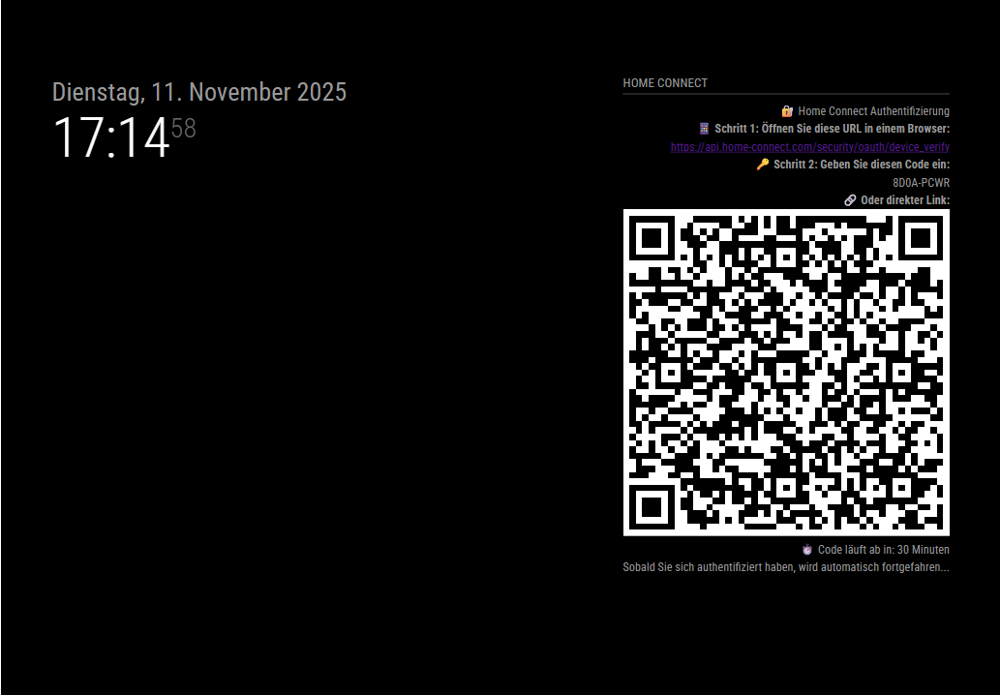

# MMM-HomeConnect2

MagicMirror module for Home Connect appliances using the OAuth2 device flow.

## Screenshot



Device states — running with progress, delayed start, finished, open door:



## Requirements

- Node.js `>=22.22.2 <23` or `>=24`, the same range as MagicMirror² 2.38 (`engines` in `package.json`)
- A Home Connect developer application, see
  [Developer Application](https://github.com/HeikoGr/MMM-HomeConnect2/wiki/Developer-Application)

## Installation

```bash
cd ~/MagicMirror/modules
git clone --recurse-submodules https://github.com/HeikoGr/MMM-HomeConnect2
cd MMM-HomeConnect2
npm ci --omit=dev
```

The module depends on the `lib/mmm-shared` git submodule. `npm ci` normally fetches it for you, but
cloning with `--recurse-submodules` makes that explicit. A ZIP download from GitHub does not contain
it. If the module fails to start with a `Cannot find module './lib/mmm-shared/mmm-shared'` error, run:

```bash
cd ~/MagicMirror/modules/MMM-HomeConnect2
git submodule update --init --recursive
```

## Update

```bash
cd ~/MagicMirror/modules/MMM-HomeConnect2
git pull
git submodule update --init --recursive
npm ci --omit=dev
```

## Configuration

```js
{
    module: "MMM-HomeConnect2",
    position: "top_left",
    config: {
        clientId: "YOUR_CLIENT_ID",
        showDeviceIcon: true,
        showDeviceIfInfoIsAvailable: true,
    },
},
```

Authentication QR example:



## Documentation

User-facing documentation now lives in the project wiki:

- [Wiki Home](https://github.com/HeikoGr/MMM-HomeConnect2/wiki)
- [Installation](https://github.com/HeikoGr/MMM-HomeConnect2/wiki/Installation)
- [Developer Application](https://github.com/HeikoGr/MMM-HomeConnect2/wiki/Developer-Application)
- [Update](https://github.com/HeikoGr/MMM-HomeConnect2/wiki/Update)
- [Quick Start](https://github.com/HeikoGr/MMM-HomeConnect2/wiki/Quick-Start)
- [Configuration](https://github.com/HeikoGr/MMM-HomeConnect2/wiki/Configuration)
- [Authentication](https://github.com/HeikoGr/MMM-HomeConnect2/wiki/Authentication)
- [Troubleshooting](https://github.com/HeikoGr/MMM-HomeConnect2/wiki/Troubleshooting)

Technical and development documentation remains in `docs/`:

- [docs/README.md](docs/README.md)
- [docs/api-call-and-event-flow-diagrams.md](docs/api-call-and-event-flow-diagrams.md)
- [docs/DEVCONTAINER.md](docs/DEVCONTAINER.md)

## Credits

- Based on [MMM-HomeConnect](https://github.com/djerik/MMM-HomeConnect) by Tobias Laursen (djerik),
  which also contributed the appliance icons in `icons/`.
- The API client in `lib/homeconnect-api.js` started as
  [home-connect-js](https://github.com/artcom/home-connect-js) by Patrick Hieber (MIT).

## License

MIT, see [LICENSE](LICENSE).
